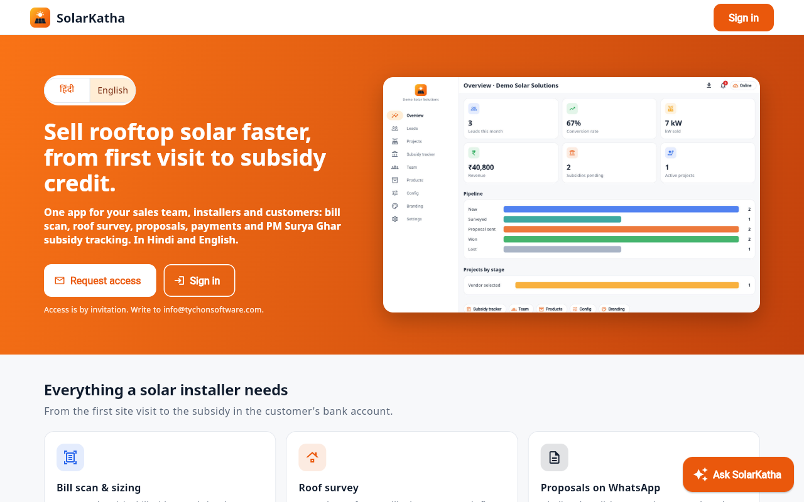
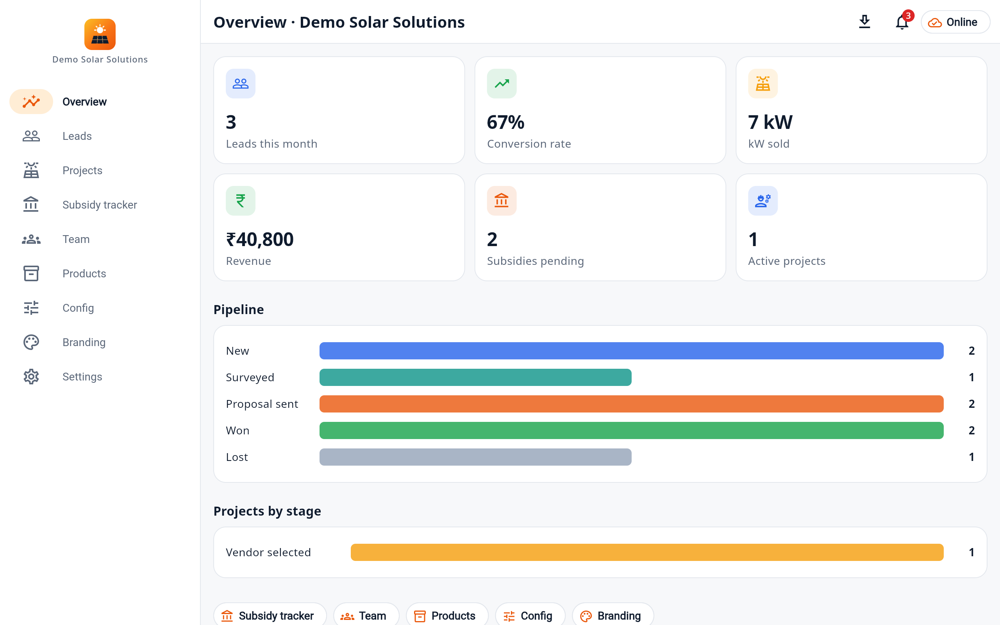
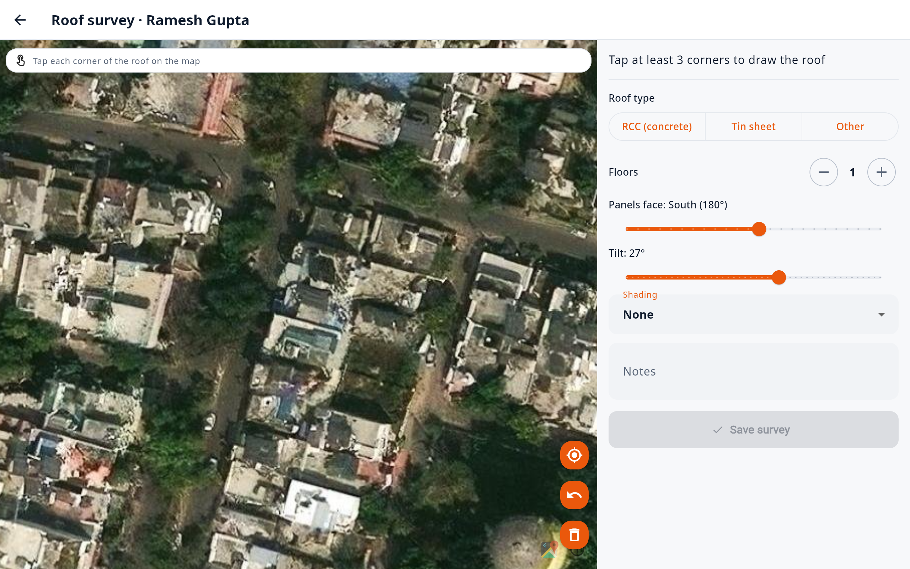
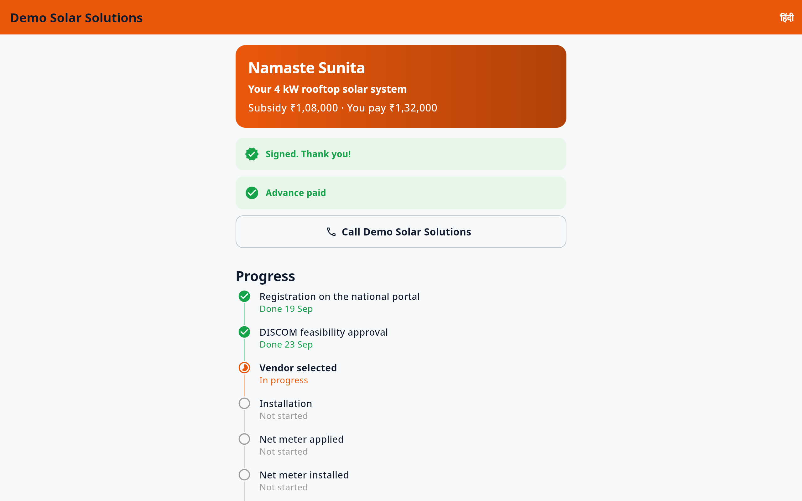
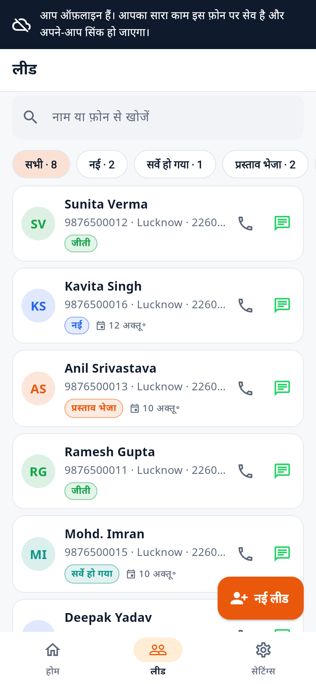
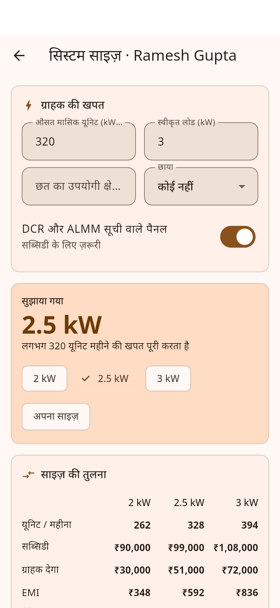
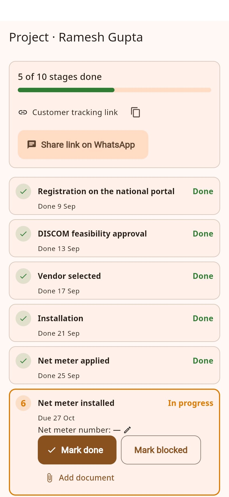
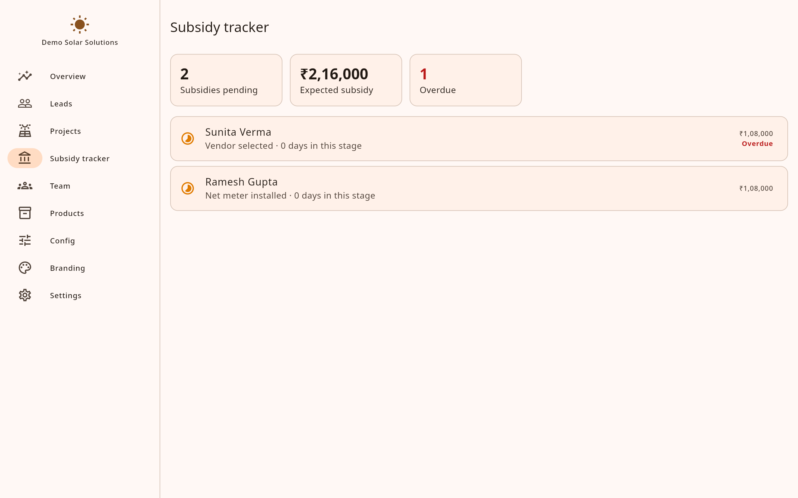
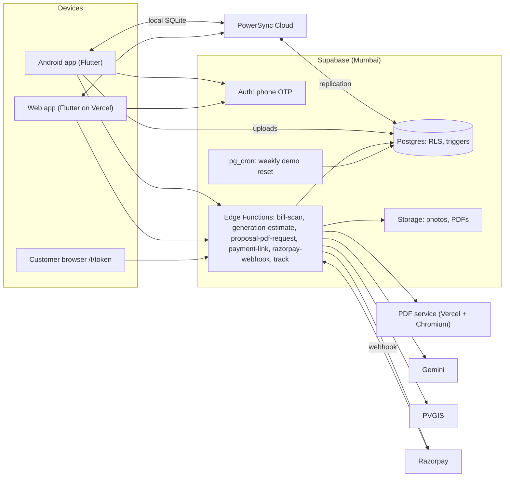

# SolarKatha

**For Indian rooftop solar installers: scan the bill, size the system, work out the PM Surya Ghar subsidy and EMI, send a Hindi or English proposal on WhatsApp, and track every customer until the subsidy is credited.**

| | |
| --- | --- |
| **Website** | https://www.solarkatha.in (landing page with savings calculator and daily solar news; Login at the top) |
| **Android app** | https://www.solarkatha.in/solarkatha.apk (signed release APK) |
| **Login** | Private: only accounts created by the administrator (mobile number + password). There is no self sign-up. |

## Screenshots

| Landing page | Owner dashboard |
| --- | --- |
|  |  |
| **Roof survey on satellite imagery** | **Customer tracking page (Hindi)** |
|  |  |

| Leads (Hindi) | Sizing (Hindi) | Project stages (installer) | Subsidy tracker |
| --- | --- | --- | --- |
|  |  |  |  |

## Features

- **Leads, offline first.** Create leads, photos and surveys with no network at the site. Everything syncs when the phone is back online (PowerSync).
- **AI bill scan.** Photograph an electricity bill and Gemini reads the units, sanctioned load and DISCOM. The rep confirms the values.
- **Sizing.**
  - Recommends a kW size from usage, roof area and sanctioned load.
  - Works out the central + state subsidy, EMI, payback and 25-year savings.
  - Shows monthly generation from PVGIS.
- **Roof survey.** The rep taps the roof corners on satellite imagery. Panels are laid out automatically using each product's own size, and the roof limits the system size.
- **Proposals.**
  - Compliance checklist (DCR, ALMM, approved inverter).
  - Hindi/English PDF shared on WhatsApp, signed on the phone.
  - Razorpay UPI link for the advance, marked paid automatically by the webhook.
- **Projects.** The 10 PM Surya Ghar stages with due dates, overdue flags, documents, installer assignment and one-tap WhatsApp updates.
- **Customer tracking page.** A public link with no login, where the customer signs, pays and follows progress. It works in Hindi or English and uses the company's colours.
- **Owner dashboard.** kW sold, revenue, conversion, subsidies pending, projects by stage, team performance, CSV export and notifications.
- **Business numbers in config.** Subsidy slabs, tariffs, loan presets, stage deadlines and WhatsApp templates can be edited per company. None are hard-coded.
- **Field-friendly.** Hindi and English everywhere, a high-contrast theme and large text for outdoor use, and layouts that work on 360 dp phones.

## Architecture



- **On the device:** the app works on a local SQLite copy kept in sync by PowerSync. Writes are queued locally and uploaded to Supabase, where row-level security applies.
- **Secrets stay on the server:** anything that needs a secret (Gemini, Razorpay, PDF signing) runs in an Edge Function.
- **Rules live in the database:** stage rules, creating the project when a proposal is signed, and notifications are database triggers. So the app, the tracking page and the payment webhook all behave the same way.

## Repository layout

```
app/                 Flutter app (Android + web)
packages/solar_core/ pure Dart solar maths (sizing, subsidy, tariff, EMI, payback)
supabase/functions/  Edge Functions: bill-scan (Gemini), generation-estimate (PVGIS)
powersync/           sync streams (paste into the PowerSync dashboard)
pdf-service/         Vercel function: proposal HTML → PDF (Chromium, Noto fonts)
supabase/            migrations, RLS policies, seed, pgTAP tests, local config
.github/workflows/   ci.yml, deploy-web.yml, release-apk.yml
DECISIONS.md         choices made where the spec was open
```


## Tech stack

Flutter (Material 3) · Riverpod 3 + riverpod_generator · go_router · freezed / json_serializable · Supabase (Postgres, Auth, Storage, Edge Functions) in Mumbai · PowerSync · Gemini (via an Edge Function) · PVGIS · Razorpay · flutter_map + Esri imagery · Vercel · GitHub Actions.

## Local setup (Windows PowerShell)

Prerequisites: Flutter stable (3.47+) on `PATH`, Chrome, and for Android builds Android Studio with the Android SDK. For the local database you also need Docker Desktop and the Supabase CLI.

```powershell
cd app
flutter pub get
flutter gen-l10n
dart run build_runner build
```

### Option A – use a hosted Supabase project

1. Create a Supabase project in the **Mumbai (ap-south-1)** region.
2. Apply the schema and seed:

   ```powershell
   npx supabase login
   npx supabase link --project-ref YOUR-PROJECT-REF
   npx supabase db push --include-seed
   ```

   Or paste `supabase/migrations/*.sql`, then `supabase/seed.sql`, into the SQL editor.
3. In the dashboard, go to **Authentication > Sign In / Providers**:
   - Enable **Phone**. Pick any SMS provider; placeholder values are fine for test numbers. Add the test numbers `919999900001`, `919999900002` and `919999900003`, each with OTP `123456`.
   - Enable **Email OTP**. In **Email Templates > Magic Link**, include `{{ .Token }}` so owners receive a 6-digit code. See `supabase/templates/magic_link.html`.
4. Copy `app/env/dev.example.json` to `app/env/dev.json`, then fill in the project URL and the publishable key.

### Offline sync (PowerSync Cloud)

Without `POWERSYNC_URL` the app still works, but data stays on that one device. To sync:

1. Create a free instance at [powersync.com](https://www.powersync.com) in a region close to Mumbai.
2. **Connect the database:** use Supabase **Project Settings → Database → Connection string** (direct connection, port 5432). The `powersync` publication already exists; the migrations created it.
3. **Client auth:** enable **Use Supabase Auth**, and paste the JWT secret / JWKS URL from Supabase **Project Settings → API**.
4. **Sync rules:** paste `powersync/sync-rules.yaml` and deploy.
5. Copy the instance URL into `app/env/dev.json` as `POWERSYNC_URL`.

### Server functions (bill scan and generation estimate)

1. Get a Gemini API key at **aistudio.google.com → Get API key**.
2. In Supabase, go to **Edge Functions → Secrets → Add new secret**. Add `GEMINI_API_KEY` with that key. You can also add `GEMINI_MODEL` to choose a different model.
3. Deploy both functions:

   ```powershell
   npx supabase login
   npx supabase functions deploy bill-scan generation-estimate --project-ref ffygaowdbkunrkdxksig
   ```

### Option B – local Supabase (Docker)

```powershell
npx supabase start          # prints the local API URL and publishable key
npx supabase test db        # runs the RLS tests
```

Copy `app/env/local.example.json` to `app/env/local.json` and paste in the key.

### Run

```powershell
cd app
flutter run -d chrome --web-port 3000 --dart-define-from-file=env/dev.json
flutter run -d <android-device-id> --dart-define-from-file=env/dev.json
```

### Demo logins (seeded company "Demo Solar Solutions", Lucknow)

| Role | Mobile | OTP |
| --- | --- | --- |
| Owner | 99999 00001 | 123456 |
| Sales rep | 99999 00002 | 123456 |
| Installer | 99999 00003 | 123456 |

The first login with each number claims the matching team invite. Any other number goes to the "Set up your company" screen.

## Checks

```powershell
cd packages/solar_core; dart run coverage:test_with_coverage; cd ../..
cd supabase/functions; deno test tests/; cd ../..
cd app
dart format --set-exit-if-changed lib test
flutter analyze
flutter test
```

## Deployment

| Part | Where | How |
| --- | --- | --- |
| Database, auth | Supabase (Mumbai) | `npx supabase db push` |
| Web app | Vercel | `deploy-web.yml` on push to `main`: `flutter build web`, then `vercel deploy --prebuilt --prod` with an SPA rewrite |
| Android APK | GitHub Releases | `release-apk.yml` on a `v*` tag builds a signed APK |

GitHub secrets:

- **Web deploy:** `APP_ENV_JSON` (the contents of your `env/*.json`), `VERCEL_TOKEN`, `VERCEL_ORG_ID`, `VERCEL_PROJECT_ID`.
- **APK release:** `ANDROID_KEYSTORE_BASE64`, `ANDROID_KEYSTORE_PASSWORD`, `ANDROID_KEY_ALIAS`, `ANDROID_KEY_PASSWORD`.

To create the release keystore once:

```powershell
keytool -genkey -v -keystore solarkatha-release.jks -keyalg RSA -keysize 2048 -validity 10000 -alias solarkatha
[Convert]::ToBase64String([IO.File]::ReadAllBytes("solarkatha-release.jks")) | Set-Clipboard
```

### Demo data

The demo company (`Demo Solar Solutions`) is rebuilt by `private.reset_demo()`. `pg_cron` runs it every Monday at 03:00 IST, and it can be run by hand from the SQL editor: `select private.reset_demo();`.

The demo has:
- 8 leads across the funnel
- bills, and proposals in Hindi and English
- two signed projects, one at stage 6 and one at stage 3
- paid advances

### Manual release (without CI)

```powershell
cd app
flutter build apk --release --dart-define-from-file=env/dev.json
flutter build web --release --dart-define-from-file=env/dev.json
```

- **Signing:** release APKs are signed with `app/android/app/solarkatha-release.jks`, using the passwords in `app/android/key.properties`. Both files are gitignored, so **back them up**: a new key cannot update an installed app.
- **Hosting:** the APK is served from the web app at `/solarkatha.apk`. Copy it into `.vercel/output/static/` before running `vercel deploy --prebuilt --prod`.
